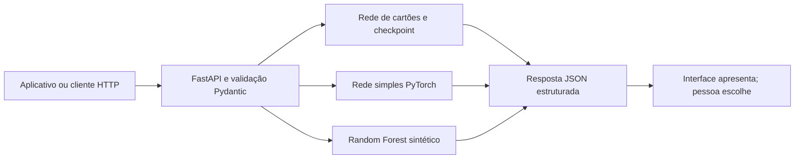

# Neural API — projeto demonstrável de inferência

**Autor:** Rafael Ricardo Mayer · **Área:** IA aplicada, APIs e tecnologia assistiva · **Estado:** protótipo experimental implementado.

## Problema e objetivo

Separar modelos e contratos HTTP da interface permite testar inferência e reaproveitar serviços em outros projetos. A Jornada de Bia é um caso de integração: a pessoa continua escolhendo o que comunicar, enquanto o laboratório permite experimentar ordenação de um catálogo sintético.

O projeto demonstra arquitetura modular, validação de entradas, inferência com PyTorch, treinamento reproduzível, uma implementação categórica de Random Forest e alternativas locais no aplicativo. Não demonstra diagnóstico, leitura de intenção ou eficácia terapêutica.

## Componentes implementados

| Componente | Contrato | Papel e limite |
|---|---|---|
| Disponibilidade | `GET /health` | Confirma resposta do serviço; não comprova que todo checkpoint está carregado. |
| Catálogo | `GET /v1/models` | Lista os modelos declarados no código. |
| Rede simples | `POST /v1/predict` | 3 entradas, 8 neurônios intermediários com ReLU, 1 saída. Pesos aleatórios, sem treinamento; valida integração, não qualidade preditiva. |
| Rede de cartões | `POST /v1/cards/suggestions` | 9 entradas codificadas, 16 neurônios com ReLU, 5 saídas. Checkpoint treinado com dados sintéticos; ordena cinco cartões e preserva duas opções fixas. |
| Random Forest | `POST /v1/cards/random-forest/suggestions` | 31 árvores categóricas, 18 contextos sintéticos, bootstrap e subespaço aleatório. Pode restringir a lista a IDs permitidos. Votos não são probabilidades calibradas. |

## Arquitetura



O serviço usa Python, FastAPI, Pydantic, PyTorch, pytest e Docker. O deploy existente usa CPU no Render. A Data API, as contas Google e o PostgreSQL da Jornada são serviços separados. Esta API não precisa conectar ao banco da família.

## Escopo dos dados

Os exemplos usam números, período do dia e ID do último cartão do catálogo de demonstração. Não incluem nome, saúde, identidade Google, histórico de frases ou prontuário. O catálogo é fixo: não é um modelo já preparado para quaisquer cartões de outros aplicativos.

A inferência não treina com requisições. O endpoint é público; CORS restringe origens de navegador, mas não equivale a autenticação. A autorização do laboratório na Jornada protege a configuração da interface e não torna a API privada.

## Treinamento e evidências

A rede de cartões é treinada por `scripts/train_cards_demo.py`, com semente 42, 1.500 exemplos sintéticos, 1.200 para treino e 300 para teste. Nesta execução reproduzível, acertou **55,3%**, contra **57,3%** da regra simples de referência. Não houve evidência de superioridade à regra.

O Random Forest é treinado uma vez ao iniciar, com 18 contextos gerados por regra explícita. O ajuste aos próprios exemplos não mede generalização. Ele usa dados e objetivos diferentes da rede; colocar os dois resultados lado a lado na demonstração não é uma comparação de qualidade.

A rede simples não foi treinada: sua saída numérica não tem significado clínico ou semântico.

## Como demonstrar

1. Apresentar o problema de desacoplar interface e inferência.
2. Abrir a página visual e escolher um dos três modelos.
3. Alterar as entradas sintéticas; mostrar requisição JSON e cartões/resultado.
4. Explicar que a página usa **respostas registradas de uma execução local**, sem chamadas ao servidor durante a exploração. São 63 cenários: 27 da rede simples e 18 de cada modelo de cartões.
5. Usar “Copiar curl” ou `examples/neural-api.http` para executar chamadas reais em outra ferramenta.
6. Mostrar as limitações e a decisão de manter a escolha com a pessoa.

A disponibilidade do serviço público deve ser conferida antes de uma apresentação. Nesta preparação, uma consulta pública não respondeu em 20 segundos; isso não comprova falha permanente. Os exemplos foram verificados localmente.

## Executar localmente

Com as dependências instaladas, gerar o checkpoint:

```bash
python -m scripts.train_cards_demo --output /tmp/modelo_cartoes_demo.pt
CARDS_MODEL_PATH=/tmp/modelo_cartoes_demo.pt uvicorn app.main:app --host 127.0.0.1 --port 8000
```

Em outro terminal:

```bash
python -m scripts.demo_api --base-url http://127.0.0.1:8000 --output demonstracao.json
```

O script usa apenas exemplos sintéticos, registra respostas reais e termina com erro se alguma chamada não retornar 200. Sem checkpoint, o endpoint neural de cartões pode retornar 503. A rede simples varia entre inicializações porque seus pesos são aleatórios.

## Próximos passos

Definir catálogos versionados para outros projetos; avaliar com métricas e referência adequadas antes de usar sugestões reais; adicionar autenticação e limites de uso antes de tratar dados privados; conferir estabilidade, disponibilidade e observabilidade. O RAG foi adiado e não integra esta entrega.

## Materiais

- `examples/neural-api.http`: exemplos de chamadas válidas e inválidas.
- `scripts/demo_api.py`: execução e evidências JSON.
- `RANDOM_FOREST_API.md`: contrato e limites do Random Forest.
- Página visual: bancada didática com cenários registrados, documento para download e opção de impressão.
